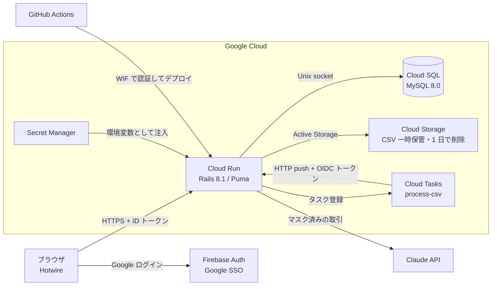

# SubMa - Subscription Mapping

> 散らばったサブスクを一枚の地図にまとめる、個人向けサブスクリプション管理アプリ

## 何ができるか

- サブスクを手動で登録・一時停止・解約済みにし、月額・年額の合計、カテゴリ別の内訳、引落日のカレンダーで一覧できる
- クレジットカード明細の CSV（楽天カード形式）を取り込むと、規則 → 繰り返しパターン → AI（Claude API）の 3 段階でサブスクらしい取引を抽出し、確認画面で選んだものをまとめて登録できる
- 取り込みに失敗したときの再実行と、アカウントと全データの削除（退会）を利用者自身が行える

## 構成図



- CSV の取り込みは、アップロードを受けた Cloud Run が Cloud Tasks にタスクを登録し、Cloud Tasks が `/internal/jobs/process_csv` を呼び出して実行する（[ADR-0003](./docs/adr/0003-csv-processing-pipeline.md)、[ADR-0007](./docs/adr/0007-csv-job-idempotency.md)）
- リソースごとの設定と選定理由は [docs/infrastructure-notes.md](./docs/infrastructure-notes.md) を参照

## 技術スタック

| 領域 | 採用 |
|---|---|
| 言語・フレームワーク | Ruby 3.4.5 / Rails 8.1 |
| フロントエンド | Hotwire（Turbo + Stimulus）、importmap、Tailwind CSS、Chartkick |
| DB | MySQL 8.0（本番は Cloud SQL） |
| 認証 | Firebase Auth（Google SSO）。ID トークンは Rails 側で自前検証（RS256・iss・aud・exp・iat・sub。[ADR-0001](./docs/adr/0001-firebase-auth-strategy.md)） |
| ファイル保管 | Active Storage（本番は Cloud Storage、開発・テストはローカルディスク） |
| 非同期処理 | 本番は Cloud Tasks。開発・テストは Sidekiq + Redis（[ADR-0003](./docs/adr/0003-csv-processing-pipeline.md)） |
| AI | Claude API（`claude-sonnet-4-6`、`anthropic` gem） |
| インフラ | Cloud Run / Cloud SQL / Cloud Storage / Cloud Tasks / Secret Manager / Artifact Registry、Terraform で管理 |
| CI/CD | GitHub Actions（RSpec・RuboCop・Brakeman・bundler-audit）、Workload Identity Federation で GCP にデプロイ |
| ログ・防御 | Lograge（JSON ログ）、Rack::Attack、secure_headers |

## 判定の仕組み

取り込んだ明細は、次の 3 段階で上から順に判定する。前の段で判定できなかった行だけが次の段に進む（[ADR-0004](./docs/adr/0004-ai-classifier-tiering.md)）。

1. **規則（Tier 1）**: 既知サービスのテンプレート（`ServiceTemplate`）の正規表現と店名を照合する。照合前に店名を Unicode NFKC で正規化する
2. **繰り返しパターン（Tier 2）**: 同じ店名・同じ金額の取引の間隔が、月額相当（25〜35 日）または年額相当（360〜370 日）になる組があればサブスク候補にする。相手は過去の取引と、同じ CSV の中の行の両方から探す
3. **AI（Tier 3）**: 残った行を Claude API に 50 件ずつ送る。店名の 4 桁以上の数字は `XXXX` に置き換え、ユーザー ID・メールアドレスは送らない。同じ店名・金額の行はまとめて 1 回だけ送る

- 携帯・回線・プロバイダなどの通信費はサブスクの対象外としている（[ADR-0008](./docs/adr/0008-exclude-telecom-from-subscriptions.md)）
- AI に送る行数には上限がある（取り込み 1 回 300 行、1 ユーザー 1 日 500 行、全体 1 日 2,000 行。環境変数で変更可）。上限を超えた行と API が失敗した行は「未判定」として保存し、取り込みは完了させる
- 判定結果は提案として表示し、利用者が確認画面でサービス名・カテゴリを直してから登録する

## セキュリティ設計の要点

詳細は [SECURITY.md](./SECURITY.md)。

- **招待制**: Google アカウントのメールアドレスが許可リストにある人だけがログインできる。許可リストが未設定・空なら全員を拒否し、リクエストごとに判定し直す（[ADR-0006](./docs/adr/0006-login-allowlist.md)）
- **内部 API の発行元確認**: Cloud Tasks からの呼び出しは、OIDC トークンの署名・aud・iss に加えて、発行した SA のメールアドレスまで確認する。本番では検証を無効にできない
- **fail-closed**: 許可するホスト名（`APP_HOST`）や内部 API の設定が無いときは、検証を省いて動かさずに停止・拒否する
- **最小権限**: Cloud Run の実行 SA とデプロイ用 SA を分け、デプロイ用 SA にはデプロイに必要なロールだけを付けている。GitHub Actions は長期の鍵を持たず、WIF で一時的に認証する
- **秘密値は gcloud で投入**: API キー・Rails の master key・許可リストは、Terraform の変数や state に入れず、運用者が `gcloud secrets versions add` で Secret Manager に入れる
- **CSV の扱い**: アップロードは拡張子・Content-Type・サイズ（1MB）・中身（マジックナンバー・文字コード・行数）を検証してから保存する。取り込みが完了したらファイルを削除し、残ったものは保存先バケットのライフサイクル（1 日）で消える（[ADR-0005](./docs/adr/0005-csv-pii-protection.md)）

## セットアップ

### 開発環境（Docker）

```bash
docker compose up
```

ブラウザで `http://localhost:3010` を開く。

- MySQL: localhost:3307（コンテナ内は `db:3306`）、Redis: localhost:6380（コンテナ内は `redis:6379`）
- 開発環境では、許可リスト（`ALLOWED_LOGIN_EMAILS`）を指定しなければ全員がログインできる
- 動作確認用のダミー明細: `public/samples/sample_rakuten.csv`

### 本番環境

Terraform による GCP の構築手順は [infra/README.md](./infra/README.md) を参照。

## 運用

Secret の投入・更新、許可リストの変更、取り込みの再処理、AI 利用量の上限、課金停止などの手順は [docs/infrastructure-notes.md](./docs/infrastructure-notes.md) の「8. 運用手順」にまとめている。

## 設計記録（ADR）

主な技術判断は [docs/adr/](./docs/adr/README.md) に記録している。

## テスト

```bash
docker compose run --rm web bundle exec rspec
```

RSpec のテストは約 450 件（モデル・サービス・ジョブ・フォーム・リクエスト・rake タスク）。CI（GitHub Actions）でも同じテストと RuboCop・Brakeman・bundler-audit を実行する。

## ドキュメント

- [SECURITY.md](./SECURITY.md): 脅威モデルと対策
- [docs/infrastructure-notes.md](./docs/infrastructure-notes.md): インフラ構成と運用手順
- [docs/adr/](./docs/adr/README.md): 設計記録
- [AI_USAGE_GUIDELINE.md](./AI_USAGE_GUIDELINE.md): AI の利用ルール
- [development-log.md](./development-log.md): 開発の経過

## ライセンス・作者

- 作者: Marin Miyazaki
- ライセンス: 設定していない（All rights reserved）
