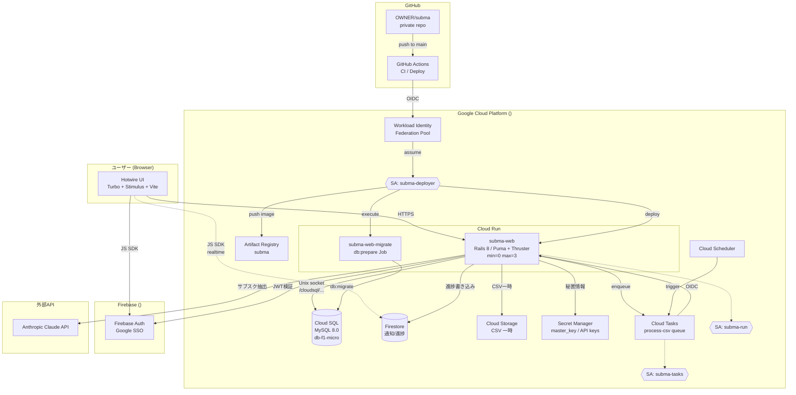
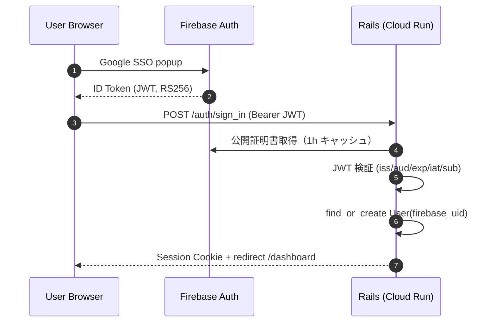
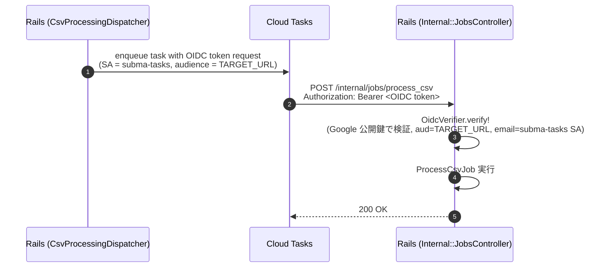

# SubMa インフラ構成ノート

> SubMa の本番インフラをどう設計・構築・運用しているか、技術選定の理由と図解付きで説明します。

## 目次

1. [全体構成図](#1-全体構成図)
2. [技術選定の理由](#2-技術選定の理由)
3. [リソース一覧と役割](#3-リソース一覧と役割)
4. [セキュリティ設計](#4-セキュリティ設計)
5. [認証・認可フロー](#5-認証認可フロー)
6. [デプロイパイプライン](#6-デプロイパイプライン)
7. [コスト試算と最適化](#7-コスト試算と最適化)
8. [運用手順](#8-運用手順)

---

## 1. 全体構成図



---

## 2. 技術選定の理由

### 2.1 なぜ Google Cloud + Cloud Run か

| 選択肢 | 採用 | 理由 |
|---|---|---|
| **Cloud Run** | ✅ | コンテナを HTTP リクエストだけで起動できる「サーバレスコンテナ」。min-instances=0 で完全にスケールゼロ可能 → 利用が少ない期間も実質無料 |
| AWS ECS Fargate | ❌ | 常時 1 タスク稼働で月 $10〜、ALB 別途必須 |
| Heroku | ❌ | 認証（Firebase Auth）・Firestore と同じ GCP に寄せた方が IAM / Secret / ログを一元管理できる |
| 自前 VPS | ❌ | TLS 終端・スケール・ロギングを全部自前で組むコスト > サーバレスの便利さ |

### 2.2 なぜ Cloud SQL（MySQL）か

| 選択肢 | 採用 | 理由 |
|---|---|---|
| **Cloud SQL MySQL** | ✅ | リレーショナルが本質に必要（サブスク↔取引の正規化）。Rails との組み合わせ実績が多く、運用ノウハウが豊富 |
| Firestore single-store | ❌ | サブスク・取引・ユーザーの関係性が複雑、Document DB だと集計クエリが書きにくい |
| Spanner | ❌ | オーバースペック・コスト高 |
| AlloyDB | ❌ | 個人開発規模ではオーバースペック |

**ハイブリッド方針**: 永続データ＝Cloud SQL、リアルタイム/通知＝Firestore（後述 ADR-0002）

### 2.3 なぜ Hotwire + Vite（SPA を採用しない）か

- Rails 8 標準の Turbo + Stimulus + Tailwind で「サーバ駆動の UX」を実現
- React/Vue を入れない → ビルド成果物が小さい → Cloud Run のコールドスタートが速い
- フロントとバックエンドを Rails 1 つに集約し、二重実装（API + SPA）を避ける

詳細: [`docs/adr/0006-hotwire-vs-spa.md`](./adr/0006-hotwire-vs-spa.md)（Phase 5 で書く予定）

### 2.4 なぜ Terraform（IaC）か

- インフラ構成をコードでレビュー・差分管理できる
- 「壊しても `terraform apply` で再構築」できる安全網
- 課金停止のために `destroy` で完全消去できる（運用上の重要メリット）

---

## 3. リソース一覧と役割

### 3.1 Cloud Run

| リソース | 用途 | 設定 |
|---|---|---|
| `subma-web` (Service) | Rails アプリ本体 | min=0, max=3, CPU=1, Mem=512Mi, cpu_idle=true |
| `subma-web-migrate` (Job) | DB マイグレーション | デプロイ後に execute |

**コスト最適化のポイント**:
- `min_instance_count = 0`: アクセスがない時間は完全停止・課金ゼロ
- `cpu_idle = true`: リクエスト処理外の CPU 課金を止める
- `startup_cpu_boost = true`: コールドスタートだけ CPU 増強

### 3.2 Cloud SQL

| 項目 | 値 |
|---|---|
| インスタンス | `subma-prod` |
| エンジン | MySQL 8.0 |
| Tier | `db-f1-micro`（共有 CPU + 0.6GB RAM）|
| Disk | PD-SSD 10GB（autoresize=true）|
| Availability | ZONAL（個人開発規模、月 ~$10）|
| Backup | 毎日 18:00 UTC、7世代保持 |
| PITR | 無効（コスト節約）|

接続方式は **Cloud Run の Unix socket マウント**（`/cloudsql/<connection_name>`）。
VPC connector 不要、Cloud SQL Auth Proxy も Cloud Run が透過的に提供。

### 3.3 Secret Manager

| Secret 名 | 用途 |
|---|---|
| `rails-master-key` | Rails encrypted credentials の復号 |
| `anthropic-api-key` | Claude API 呼び出し（Tier 3 分類器）|
| `firebase-web-api-key` | Browser 側 Firebase SDK 初期化（コードに埋め込まない方針）|
| `cloud-sql-app-password` | Terraform が `random_password` で自動生成 |

Cloud Run の `env.value_source.secret_key_ref` で参照。アプリコードからは普通の環境変数として読める。

### 3.4 Service Accounts と最小権限

| SA | 用途 | 付与権限 |
|---|---|---|
| `subma-run` | Cloud Run runtime | cloudsql.client / secretmanager.secretAccessor / cloudtasks.enqueuer / storage.objectAdmin (CSV bucket only) |
| `subma-tasks` | Cloud Tasks OIDC | run.invoker (subma-web only) |
| `subma-deployer` | GitHub Actions deploy | run.admin / cloudsql.admin / secretmanager.admin / artifactregistry.writer / iam.serviceAccountUser / storage.admin |

### 3.5 Workload Identity Federation

GitHub Actions が **長期 SA キー JSON を持たずに** GCP に認証する仕組み。

```
GitHub Actions Job
  ↓ OIDC token（issuer: token.actions.githubusercontent.com）
WIF Provider（subma-github-pool / github-actions）
  ↓ attribute.repository == 'OWNER/subma' で制約
subma-deployer SA を impersonate
  ↓ short-lived アクセストークン
GCP API 呼び出し
```

**セキュリティ上のメリット**:
- 漏洩リスクの高い SA キー JSON を CI に置かない
- 特定リポジトリの workflow からしか impersonate 不可

### 3.6 Cloud Storage

| バケット | 用途 | 特殊設定 |
|---|---|---|
| `<PROJECT_ID>-subma-csv-temp` | CSV 一時保管 | **lifecycle: 1日で削除**（PII 永続化防止 / NFR-S-09）|
| `subma-tfstate` | Terraform state | バージョニング有効 |

### 3.7 その他

- **Firestore**: Native モード、`(default)` database、`delete_protection_state=ENABLED`
- **Cloud Tasks**: `process-csv` queue、max-concurrent=5、retry=3
- **Cloud Scheduler**: 引落リマインド用 cron（v2 で本格利用）
- **Artifact Registry**: `subma` Docker repo、asia-northeast1

---

## 4. セキュリティ設計

### 4.1 多層防御の階層

```
┌───────────────────────────────────────────────┐
│ レイヤー 1: ネットワーク                       │
│  - Cloud Run: HTTPS 強制（自動 TLS）           │
│  - Cloud SQL: 公開 IP だが authorized=空        │
│    → Cloud SQL Proxy(Unix socket) 経由のみ受付  │
├───────────────────────────────────────────────┤
│ レイヤー 2: 認証                               │
│  - Firebase Auth による Google SSO              │
│  - Rails 側は自前で RS256 JWT 検証              │
│  - 公開証明書は 1h キャッシュ                   │
├───────────────────────────────────────────────┤
│ レイヤー 3: 認可                               │
│  - Internal::JobsController は Cloud Tasks SA の│
│    OIDC トークン検証で保護（OidcVerifier）       │
│  - allUsers が叩けるのは公開ページのみ           │
├───────────────────────────────────────────────┤
│ レイヤー 4: アプリ防御                          │
│  - Rack::Attack（sign_in 5/min, CSV 10/5min）   │
│  - secure_headers (CSP / HSTS / XFO 等)         │
│  - Brakeman / bundler-audit を CI 必須化        │
├───────────────────────────────────────────────┤
│ レイヤー 5: データ保護                          │
│  - Secret Manager で全機密値管理                 │
│  - **CSV は処理後 1日で削除** (NFR-S-09)        │
│  - Claude API 送信前に PII マスク (NFR-S-10)    │
│  - 全書込操作で AuditLog 記録 (NFR-S-05)        │
└───────────────────────────────────────────────┘
```

### 4.2 PII（個人情報）保護方針

CSV にはクレカ番号下4桁・氏名・住所がノイズで含まれる可能性があるため:

1. **保管期間最小化**: Cloud Storage の lifecycle で 1 日経過したオブジェクト自動削除
2. **AI 送信時マスキング**: `AiClassifier#mask_pii` で 4桁以上の数字を `XXXX` に置換してから送信
3. **永続データの最小化**: `transactions` テーブルには `description`（店名）と `amount` のみ。CSV の生データ列は保持しない

---

## 5. 認証・認可フロー

### 5.1 ユーザーログイン



### 5.2 Cloud Tasks → Internal API（OIDC 認証）



- 発行元の確認: Google の ID トークンは任意の GCP プロジェクトの SA が任意の aud で発行できるため、aud / iss に加えて `email` が環境変数 `CLOUD_TASKS_SA_EMAIL` と一致し `email_verified == true` であることを必須にしている。不一致は 401。
- `CLOUD_TASKS_SA_EMAIL` は Terraform が `google_service_account.cloud_tasks.email` から Cloud Run に注入する（tfvars への手書き不要。enqueue 時の発行 SA と同じ値）。未設定・空ならジョブを実行せず 500 を返す（fail-closed）。

---

## 6. デプロイパイプライン

### 6.1 流れ

```
git push origin main
  ↓
GitHub Actions (.github/workflows/deploy.yml)
  ↓ OIDC token
WIF (subma-github-pool/github-actions)
  ↓ impersonate
subma-deployer SA
  ↓
[1] docker build
[2] docker push → Artifact Registry
[3] gcloud run deploy → subma-web 更新
[4] gcloud run jobs execute subma-web-migrate → db:prepare
[5] URL を summary 出力
```

### 6.2 Terraform と CI/CD の責務分離

| 領域 | 管理者 | 理由 |
|---|---|---|
| インフラ定義（IAM/Secret/SQL/Bucket 等）| Terraform | 構成変更を git で追跡 |
| アプリ image 差し替え | GitHub Actions | リリース頻度が高いため CI で完結したい |
| Secret 値の追加・更新 | gcloud / Terraform | 値は Terraform 管理外 |

Cloud Run service の `template[0].containers[0].image` は Terraform の `lifecycle.ignore_changes` で除外 → デプロイで CI が上書きしても Terraform plan に差分が出ない。

---

## 7. コスト試算と最適化

### 7.1 月額試算（個人開発規模の運用）

| サービス | 月額目安 | 備考 |
|---|---|---:|
| Cloud SQL `db-f1-micro` | **~$10** | 最大の出費 |
| Cloud Run | $0〜$2 | idle=$0、リクエスト分のみ |
| Cloud Storage | < $0.10 | CSV は 1 日で消える |
| Secret Manager | < $0.10 | 4 secret × $0.06 = $0.24/月 |
| Firestore | $0 | 無料枠内 |
| Cloud Tasks | $0 | 無料枠 100万ops/月 |
| Cloud Scheduler | $0 | 3 jobs まで無料 |
| Artifact Registry | ~$0.50 | ストレージ最小 |
| Cloud Logging | $0 | 50GB/月まで無料 |
| **合計** | **~$10〜13** | |

**初回特典**: 新規 GCP ユーザーには $300 / 90日 の無料クレジット → 最初の 2〜3 ヶ月は実質無料

### 7.2 コスト削減の工夫

| 削減策 | 効果 |
|---|---|
| Cloud Run min_instances=0 | idle 時間ぶん $0 |
| Cloud Run cpu_idle=true | 非アクティブ CPU 課金停止 |
| Cloud SQL ZONAL（HA なし） | REGIONAL の半額 |
| Cloud SQL PITR 無効 | バックアップ追加料金ゼロ |
| Storage lifecycle 1日 | CSV 永続化なし |
| Artifact Registry 古い image 自動削除（手動運用） | リポジトリサイズ抑制 |

---

## 8. 運用手順

### 8.1 初回構築

```bash
# 1. gcloud 認証 (一回だけ)
gcloud auth login
gcloud auth application-default login

# 2. Terraform state バケット作成 (循環依存回避のため手動)
gcloud storage buckets create gs://subma-tfstate \
  --project=<PROJECT_ID> \
  --location=asia-northeast1 \
  --uniform-bucket-level-access

# 3. Terraform 実行
cd infra/terraform
terraform init -backend-config="bucket=subma-tfstate" -backend-config="prefix=prod"
terraform plan -out=plan.out
terraform apply plan.out

# 4. WIF/SA 情報を GitHub Variables/Secrets に登録
terraform output workload_identity_provider
terraform output deployer_service_account
gh variable set GCP_WIF_PROVIDER --body "$(terraform output -raw workload_identity_provider)"
gh variable set GCP_DEPLOYER_SA --body "$(terraform output -raw deployer_service_account)"
gh variable set GCP_PROJECT_ID --body "<PROJECT_ID>"

# 5. 初回デプロイ
git push origin main  # → GitHub Actions が deploy.yml を実行
```

### 8.2 通常運用

| やりたいこと | コマンド |
|---|---|
| アプリ更新 | `git push origin main` （自動デプロイ）|
| インフラ変更 | `terraform plan` → review → `terraform apply` |
| Cloud Run ログ | `gcloud run services logs read subma-web --region=asia-northeast1` |
| DB 接続（手元から） | `gcloud sql connect subma-prod --user=subma_app --database=subma_production` |
| Secret 値の更新 | `gcloud secrets versions add anthropic-api-key --data-file=- < new_key.txt` |

### 8.3 課金停止（一時的にコストゼロにする）

**方式 A: Cloud SQL だけ停止**（再開が早い・5分）
```bash
gcloud sql instances patch subma-prod --activation-policy=NEVER
# 停止中も $1〜2/月のディスク課金あり
```

**方式 B: 全リソース完全削除**（再構築は terraform apply で 15 分）
```bash
cd infra/terraform
# 削除保護を一時無効化
sed -i.bak 's/deletion_protection = true/deletion_protection = false/' cloud_sql.tf
sed -i.bak 's/delete_protection_state = "DELETE_PROTECTION_ENABLED"/delete_protection_state = "DELETE_PROTECTION_DISABLED"/' firestore.tf
terraform apply -auto-approve
terraform destroy -auto-approve
```

### 8.4 障害対応の入口

| 症状 | 確認先 |
|---|---|
| ログインできない | Firebase Auth コンソール / `gcloud run services logs read` |
| 500 エラー | Cloud Logging（lograge JSON 検索）|
| DB 接続エラー | Cloud SQL ダッシュボード / `gcloud sql instances describe` |
| デプロイ失敗 | GitHub Actions の Job log |

---

## 関連ドキュメント

- [`SECURITY.md`](../SECURITY.md): 脅威モデルと対策
- [`AI_USAGE_GUIDELINE.md`](../AI_USAGE_GUIDELINE.md): AI 利用時の機密情報取扱
- [`SubMa_Design.md`](../SubMa_Design.md): プロダクト全体設計
- [`docs/adr/`](./adr/): 個別の意思決定記録

[ai-assisted]
